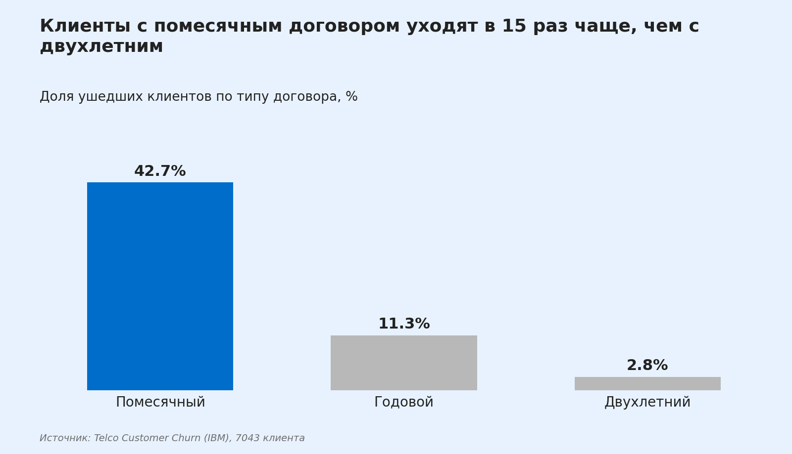
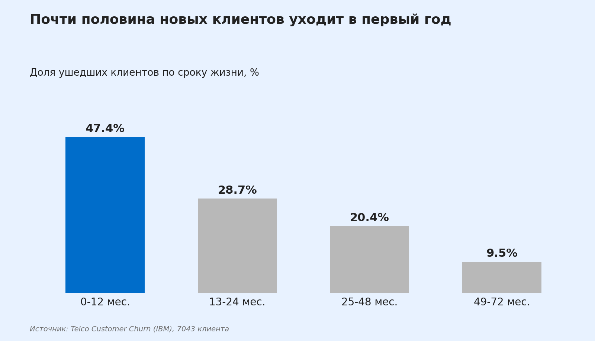
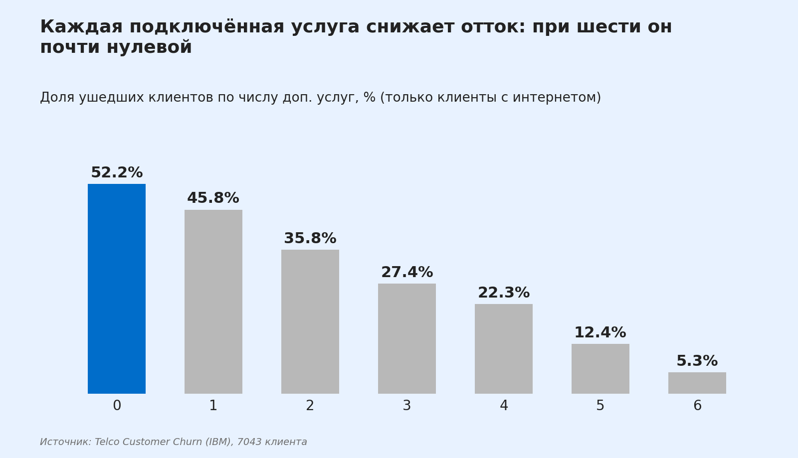
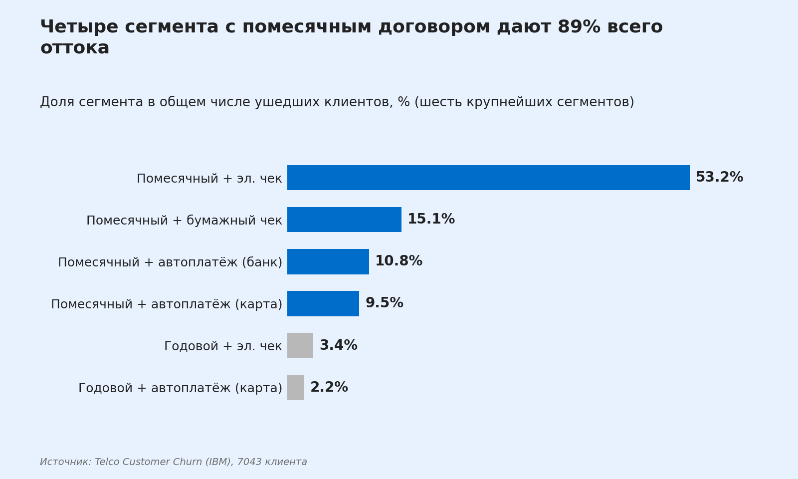

# Анализ оттока клиентов телеком-оператора

**Кратко:** 26,5% клиентов ушли, а вместе с ними 30,5% месячной выручки. Больше половины оттока дают клиенты с помесячным договором, которые платят электронным чеком. Удерживать их нужно в первый год жизни, переводя на автоплатёж и долгосрочный договор и подключая дополнительные услуги.

**Стек:** Python (pandas, matplotlib), SQL (SQLite, запросы совместимы с PostgreSQL)

---

## 1. Бизнес-задача

Оператор теряет клиентов, а привлечение нового обходится дороже удержания старого. Нужно понять:

1. Как велик отток и сколько выручки он уносит?
2. В каких сегментах клиентов он сосредоточен?
3. Куда направить меры по удержанию и какой эффект они могут дать?

## 2. Данные

Открытый датасет [Telco Customer Churn](https://github.com/IBM/telco-customer-churn-on-icp4d/blob/master/data/Telco-Customer-Churn.csv) (IBM): 7043 клиента, 21 признак (демография, тип договора, срок жизни, услуги, способ оплаты, ежемесячный платёж, признак ухода). Одна строка равна одному клиенту.

**Проверка качества.** Дубликатов `customerID` нет, пропусков нет. Единственная проблема: `TotalCharges` читается как текст, потому что у 11 клиентов с нулевым стажем значение пустое. Это новые клиенты, ещё ничего не оплатившие, поэтому я заполнил пропуски нулями.

**Определения.** Отток (churn) означает `Churn = 'Yes'`. Churn rate — доля ушедших клиентов в группе.

## 3. Что сделано

| Шаг | Файл |
|---|---|
| Загрузка, чистка, общий churn rate, первая сегментация | `01_profile_and_segments.py` |
| Загрузка данных в SQLite | `load_to_sqlite.py` |
| 8 SQL-запросов: срезы, рейтинг сегментов, Парето, оценка эффекта | `queries.sql` |
| Четыре графика для выводов | `02_charts.py`, `charts/` |

В SQL-части использованы CTE, оконные функции (`SUM() OVER`, `RANK()`, `AVG() OVER (PARTITION BY ...)`), накопительные суммы и условная агрегация через `CASE`.

## 4. Ключевые выводы

### Общий уровень оттока
Из 7043 клиентов ушли 1869, то есть **26,5%**. Они платили **30,5% всей месячной выручки**.

### Долгосрочный договор почти полностью защищает от ухода


Клиенты с помесячным договором уходят в 15 раз чаще, чем с двухлетним: 42,7% против 2,8%.

### Отток начинается в первый год


В первый год уходит 47,4% клиентов, а среди всех ушедших 55,5% отработали не больше 12 месяцев.

### Дополнительные услуги связаны с удержанием


Среди клиентов с интернетом churn снижается почти равномерно: 52,2% без дополнительных услуг и 5,3% при шести. Отдельно выделяется техподдержка: 15,2% churn с ней и 41,6% без неё.

### Отток сосредоточен в нескольких сегментах


- Сегмент «помесячный договор + электронный чек» включает 1850 клиентов (26% базы). Churn в нём **53,7%**, и на него приходится **53,2% всех ушедших**.
- Четыре сегмента с помесячным договором вместе дают **88,6% оттока**.

### Другие заметные различия
- Оплата электронным чеком: churn 45,3%. При автоплатеже он 15-17%.
- Оптоволокно (Fiber optic): 41,9%, DSL: 19,0%.
- Пенсионеры: 41,7%, остальные клиенты: 23,6%.
- Безбумажный счёт: 33,6%, бумажный: 16,3%.
- При помесячном договоре клиенты с платежом выше среднего уходят чаще: 52,2% против 29,4%.

## 5. Рекомендации

1. **Работать с первым годом.** Запускать удержание сразу после подключения: контакт на 1-3 месяце, а не после сигнала об уходе.
2. **Переводить на автоплатёж.** Бонус или скидка за подключение автоплатежа. Приоритет — сегмент «помесячный + электронный чек».
3. **Предлагать годовой договор** помесячным клиентам со скидкой или бонусом. Разница в churn с годовым договором (42,7% против 11,3%) показывает потенциал, но причинность нужно проверить (см. ограничения).
4. **Продвигать пакеты услуг, особенно техподдержку,** новым клиентам: онлайн-безопасность, резервное копирование, техподдержка.
5. **Изучить причины ухода на оптоволокне.** Высокий churn при высоком платеже может означать проблемы с качеством или конкуренцию. Для этого нужны данные опросов или обращений.

### Оценка эффекта (сценарий)
Если в сегменте «помесячный договор + электронный чек» снизить churn на 10 процентных пунктов, сохранится около **185 клиентов** и около **13,9 тыс. у.е. месячной выручки**.

Это сценарный расчёт, а не прогноз: он предполагает, что меры реально дают снижение на 10 п.п., и не учитывает их стоимость.

## 6. Ограничения

- **Корреляция не доказывает причину.** Например, электронный чек может быть не причиной ухода, а признаком менее лояльной аудитории. Чтобы проверить меры, нужен A/B-тест.
- Датасет статичен: в нём нет дат, поэтому нельзя оценить динамику и сезонность.
- Нет данных о стоимости удержания, поэтому окупаемость мер не рассчитана.
- Датасет учебный, а не данные реальной компании, поэтому конкретные цифры не переносятся на другой бизнес. Переносится подход к анализу.

## 7. Что можно добавить

- Модель логистической регрессии или дерева решений для ранжирования признаков по важности.
- Расчёт CLV по сегментам, чтобы приоритизировать удержание по ценности клиентов.
- Дашборд в BI-инструменте с фильтрами по сегментам.

## 8. Как воспроизвести

```bash
pip install pandas matplotlib
python 01_profile_and_segments.py   # профиль данных и первая сегментация
python load_to_sqlite.py            # создаёт telco.db
# выполните queries.sql в DB Browser for SQLite или DBeaver
python 02_charts.py                 # строит графики в папке charts/
```

## 9. Структура репозитория

```
├── README.md
├── 01_profile_and_segments.py
├── 02_charts.py
├── load_to_sqlite.py
├── queries.sql
└── charts/
    ├── 1_churn_by_contract.png
    ├── 2_churn_by_tenure.png
    ├── 3_churn_by_services.png
    └── 4_churn_pareto_segments.png
```
